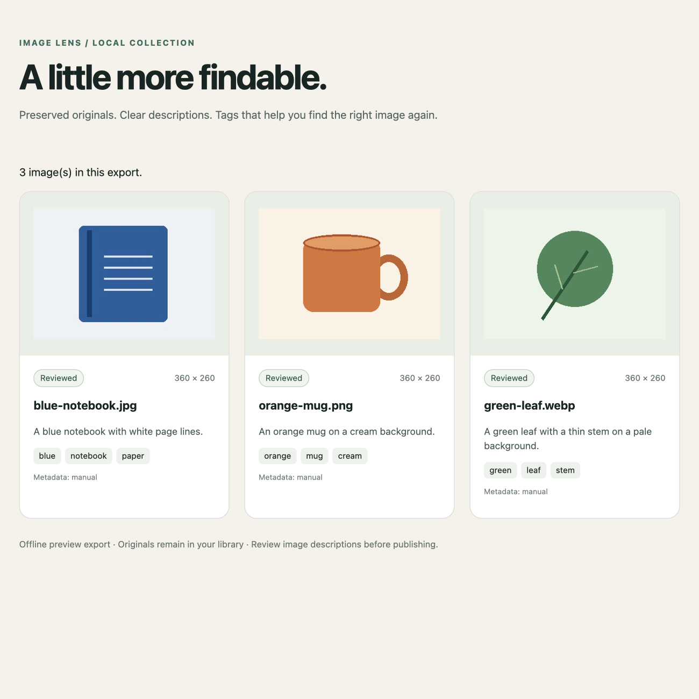

# Image Lens

A local image library that preserves original bytes, stores editable alt text and
tags, and makes images searchable. Export exact originals, a JSON index, or a
portable offline preview gallery. Python 3.11+, SQLite and Pillow; no accounts or
paid APIs required for the offline workflow.



**Today's working milestone is the offline library.** The optional local vision
adapter has protocol/failure tests, but real AI labeling has not been validated:
the available installed models support text or embeddings, not vision. No image
was sent to a hosted provider. Product-photo cleanup is outside this release.

## Try it

```sh
python3 -m venv .venv
.venv/bin/python -m pip install .
.venv/bin/imagelens --library /tmp/imagelens-library init
.venv/bin/imagelens --library /tmp/imagelens-library add examples/images/orange-mug.png

# ID of the committed synthetic mug image, also printed by add:
IMAGELENS_ID=cc876ae7f65697346ec415c30a61fb270e54fb1b08f404a211cddde63e5e7199
.venv/bin/imagelens --library /tmp/imagelens-library edit "$IMAGELENS_ID" \
  --alt 'An orange mug on a cream background.' --tag orange --tag mug
.venv/bin/imagelens --library /tmp/imagelens-library search 'ORANGE mug'
.venv/bin/imagelens --library /tmp/imagelens-library export --out /tmp/image-index.json
.venv/bin/imagelens --library /tmp/imagelens-library gallery --out /tmp/image-gallery
.venv/bin/imagelens --library /tmp/imagelens-library export-original "$IMAGELENS_ID" --out /tmp/mug-original.png
```

Open `/tmp/image-gallery/index.html` in a browser. The gallery needs no server,
JavaScript, external fonts or remote resources. It contains derived PNG previews
and `metadata.json`; previews are also embedded in the HTML so it opens without
file-origin resource permissions. Originals stay in the library. See the
[synthetic example export](evals/observed/2026-11-20/gallery/index.html).

`list` lists all records; `show ID` inspects one. `edit` replaces the complete alt
text/tag set and marks it reviewed by default; omit `--tag` to clear all tags.
Use `--needs-review` to keep a manual edit unreviewed. Reviewed is a user workflow
flag, not automatic factual verification. Empty alt text is allowed for deliberate
decorative-image use; newly imported images also begin empty and need review.

## Import and search semantics

- Single-frame PNG, JPEG and WebP are accepted by decoded format, regardless of
  filename extension. Imports reject invalid/truncated, unsupported, animated,
  oversized or nonregular inputs. Final-component symlinks are refused.
- Maximum 10 MiB per input, 20 million pixels and 5,000 images per library.
  Imports identify, verify and fully decode the image before storing it.
- Originals are stored under `objects/<SHA256>.<actual extension>`. Their exact
  bytes, including existing EXIF, are preserved; the application does not rewrite
  them. Object files are created read-only. This is accidental-write protection,
  not immutable storage against a user who changes filesystem permissions.
- SHA-256 is the image ID. Reimporting identical bytes keeps the first filename,
  creation time and existing metadata. Pixel-identical files with different
  encodings/metadata are separate images. This is not perceptual deduplication.
- Metadata is stored in `index.sqlite3`. Alt text is at most 1,000 characters;
  up to 20 tags of 1–50 characters. Tags are trimmed and deduplicated with
  Unicode casefolding. Unicode text and ordinary punctuation are preserved.
- Search splits a 1–200 character query on whitespace. Every term must occur as
  a literal, casefolded substring somewhere in the filename, alt text or tags.
  Results sort by image ID. No SQL query syntax, wildcard expansion, embeddings
  or semantic image search is used.
- Original export/preview/vision preparation recheck the stored object's path,
  hash, actual image format and dimensions. Corrupted objects are refused.
  Failed imports clean up newly created objects without discarding existing data.

Gallery export is limited to 200 images; add `--query 'green leaf'` to select a
subset. Previews apply EXIF orientation, fit within 512×512 pixels and omit EXIF
metadata. All HTML text/attributes are escaped and scripts are disabled. JSON
export contains metadata and original-object references, not the original bytes.
Use original export when you need those bytes; copying just the JSON is not a
library backup. Back up the database and objects together while no writes occur.

All output files/directories must be new and their parents must exist. Existing
destinations and broken symlinks are refused. Single-file exports publish
atomically without clobbering; gallery creation claims a new directory and removes
its own partial output on failure. Concurrent readers can see a gallery while it
is being written. There is no delete command. Library directories are explicitly
selected with `--library`; opening one creates it if absent. This local utility is
not a sandbox for hostile filesystem/database manipulation.

## Optional vision adapter — not live validated

An operator must separately provide an **already installed local GGUF vision
model** and running Ollama server. Image Lens neither downloads models nor starts
services. No model name is guessed; `--model` is required.

```sh
.venv/bin/imagelens check-model --model YOUR_INSTALLED_VISION_MODEL
.venv/bin/imagelens --library /tmp/imagelens-library suggest "$IMAGELENS_ID" \
  --model YOUR_INSTALLED_VISION_MODEL --out /tmp/vision-draft.json
# Inspect/edit the proposal before applying it:
.venv/bin/imagelens --library /tmp/imagelens-library apply /tmp/vision-draft.json
```

`/api/show` must advertise vision and local GGUF format; advertised remote routes
and `:cloud` model names are refused. Only numeric loopback HTTP endpoints are
accepted (`--base-url`, default `http://127.0.0.1:11434`); proxies and redirects
are disabled. `--timeout` defaults to 90 seconds, maximum 180 per request.
Use a trusted local server; the client does not sandbox the server's behavior.

Capability checks happen before image bytes are read/sent. A vision request sends
one orientation-corrected image fitted within 1024×1024, encoded as PNG pixels
with EXIF removed. Smaller previews can hide small text/details. Only that image
is attached; filenames and other library records are omitted. Requests are capped
at 8 MiB, model information at 2 MiB and generated responses/draft reads at 64 KiB.
The REST image format and model capability check follow the official
[Ollama vision](https://docs.ollama.com/capabilities/vision) and
[model-details](https://docs.ollama.com/api-reference/show-model-details) interfaces.

Suggestions are saved as separate JSON drafts and leave current metadata intact.
Drafts retain model settings, capability, source/prepared-image hashes, dimensions,
baseline metadata and the proposal. Applying a draft checks image identity and
compares baseline metadata inside the same SQLite write transaction as the edit.
A stale draft cannot replace a newer edit. Applied suggestions are marked
`vision`/`needs_review`; use `edit` to save a reviewed human revision. Drafts are
editable artifacts, not signed proof that a model ran. Shape/hash validation does
not establish descriptive accuracy or resistance to instructions embedded in an
image. Human review remains necessary.

The shipped adapter was tested with synthetic mocked responses and an actual
text-model capability refusal. **No real vision description, tagging accuracy or
photo cleanup was evaluated.** See [validation evidence](evals/RESULTS.md).

## Validate

```sh
PYTHONPATH=src .venv/bin/python -W error::ResourceWarning -m unittest discover -s tests -v
.venv/bin/python evals/run_offline.py --out /tmp/imagelens-offline-eval
```

Observed: 29 tests passed and 5/5 offline known-answer checks passed. CI installs
the package on Python 3.11 and 3.14 and tests the offline workflow and installed
CLI. It needs no model or model download. Exit `0` means command success; exit `2`
means an input, I/O, database, integrity, model-capability or protocol failure.

Next checkpoint: validate a separately supplied local vision model on known-answer
images and revise inaccurate drafts. Broader AI quality tests and photo cleanup
remain backlog; the full queued AI image tool is unfinished.
